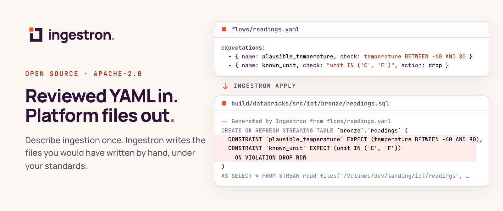
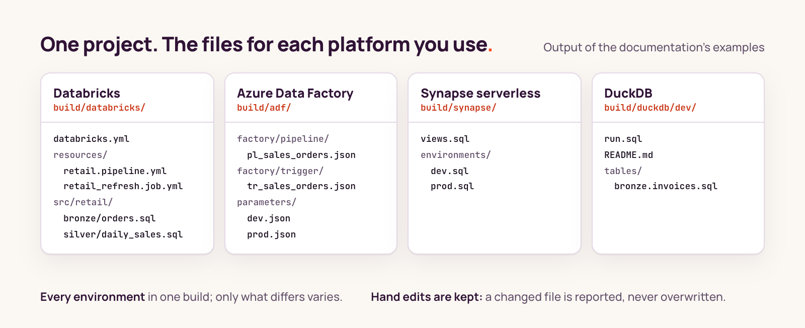

<picture>
  <source media="(prefers-color-scheme: dark)" srcset="https://raw.githubusercontent.com/ingestron/.github/main/profile/assets/hero-dark.png">
  
</picture>

<p align="center">
  <a href="https://docs.ingestron.io"><b>Documentation</b></a>
  &nbsp;·&nbsp;
  <a href="https://docs.ingestron.io/docs/start/first-project"><b>First project</b></a>
  &nbsp;·&nbsp;
  <a href="https://github.com/ingestron/ingestron"><b>Source</b></a>
  &nbsp;·&nbsp;
  <a href="https://www.npmjs.com/package/ingestron"><b>npm</b></a>
</p>

## Try it

You need Node.js 22.13 or later. No cloud account and no data source are needed.

```sh
npm install -g ingestron
ingestron init shop --template duckdb --yes
cd shop
ingestron plan     # what would be written, with diffs
ingestron apply    # write it
```

That creates a project from the DuckDB starter and writes its SQL. [Run your first project on your laptop](https://docs.ingestron.io/docs/start/first-project) runs that SQL with DuckDB, explains each file, then changes the project and breaks it on purpose. [Install a tool](https://docs.ingestron.io/docs/start/install) covers a global install and the VS Code extension.

## What you get

<picture>
  <source media="(prefers-color-scheme: dark)" srcset="https://raw.githubusercontent.com/ingestron/.github/main/profile/assets/files-dark.png">
  
</picture>

Ingestron writes the files a data engineer would otherwise write by hand. You describe sources, tables and rules in YAML your team reviews; Ingestron applies your organisation's standard and writes ordinary platform files. You deploy them with your platform's own tools, from your own CI/CD pipeline.

- **One build for every environment.** Each platform gets one set of files with only what differs between dev and prod varying, so a reviewer sees exactly what changes.
- **Nothing of Ingestron at run time.** The generated files need only your platform, and you edit them yourself if you stop using Ingestron.
- **Your edits are kept.** A file someone changed by hand is reported as a conflict and never overwritten.

## Your standards on every project

The platform team writes one standard: the packs, names, layers, types, default settings, the settings no project may change, and what every data product must declare. [VS Code](https://docs.ingestron.io/docs/tools/vscode) marks a break as you type, `ingestron plan` reports it, and `ingestron check` fails the CI build when the generated files are out of date. See [Set your organisation's standard](https://docs.ingestron.io/docs/how-to/configure-a-standard).

## What it does not do

- It does not connect to your sources or your cloud.
- It does not deploy anything. Your platform's tools do.
- It does not read secret values. A `${secret:…}` reference carries only the secret's name.
- It does not send telemetry, from the command line or from VS Code.

## Repositories

| Repository | What it holds |
| :--- | :--- |
| [ingestron](https://github.com/ingestron/ingestron) | The `ingestron` command and the libraries it is built from |
| [pack-databricks](https://github.com/ingestron/pack-databricks) | Databricks bundles and Lakeflow pipelines |
| [pack-adf](https://github.com/ingestron/pack-adf) | Azure Data Factory copies from sources your data platform cannot reach |
| [pack-synapse](https://github.com/ingestron/pack-synapse) | Azure Synapse serverless SQL views |
| [pack-duckdb](https://github.com/ingestron/pack-duckdb) | DuckDB tables and transforms, locally or in an Azure job |
| pack-fabric | Microsoft Fabric: coming soon |
| [vscode](https://github.com/ingestron/vscode) | The VS Code extension: problems as you type, completion, hover and generated-file previews |
| [docs](https://github.com/ingestron/docs) | The documentation site, [docs.ingestron.io](https://docs.ingestron.io) |

## Open source

Ingestron is licensed under Apache-2.0. The packs and the command are open source, and the documentation is built from them, so what it says matches what the code does.

## Contact

Questions and feedback: [hello@ingestron.io](mailto:hello@ingestron.io). Report vulnerabilities privately to [security@ingestron.io](mailto:security@ingestron.io); please do not include live secrets or customer data.

<sub>Ingestron is an independent project made by IntentLabs. Original code is licensed under Apache-2.0.</sub>
